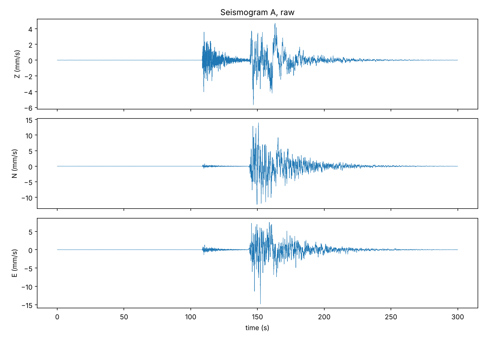
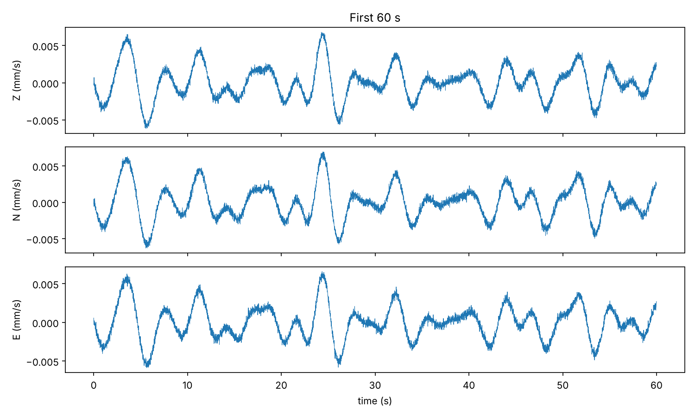
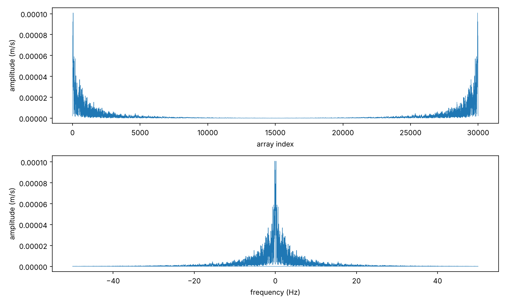
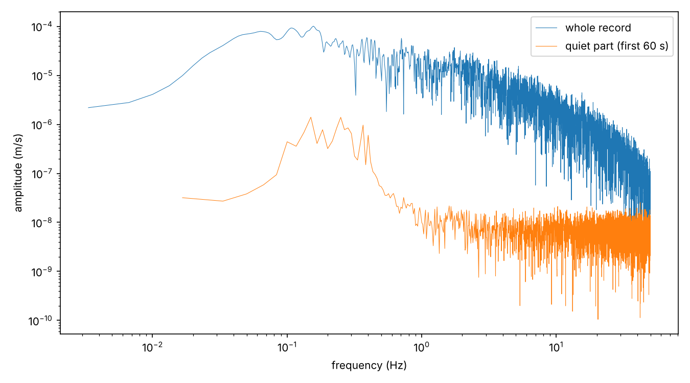
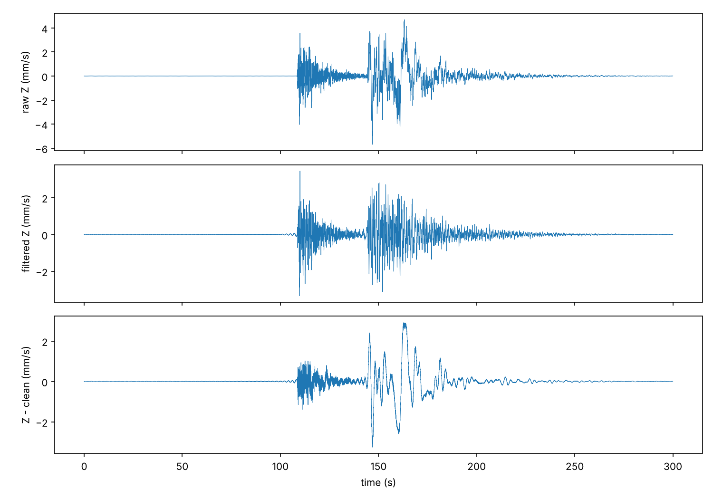
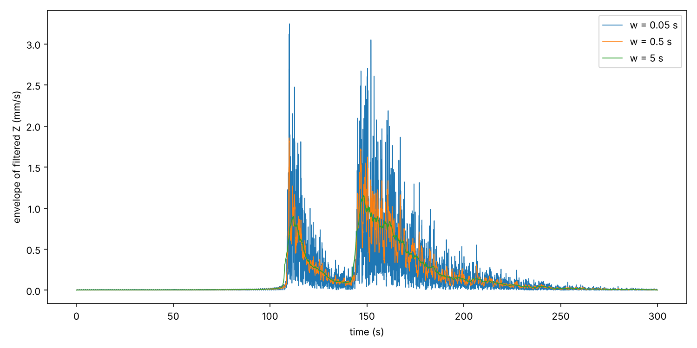
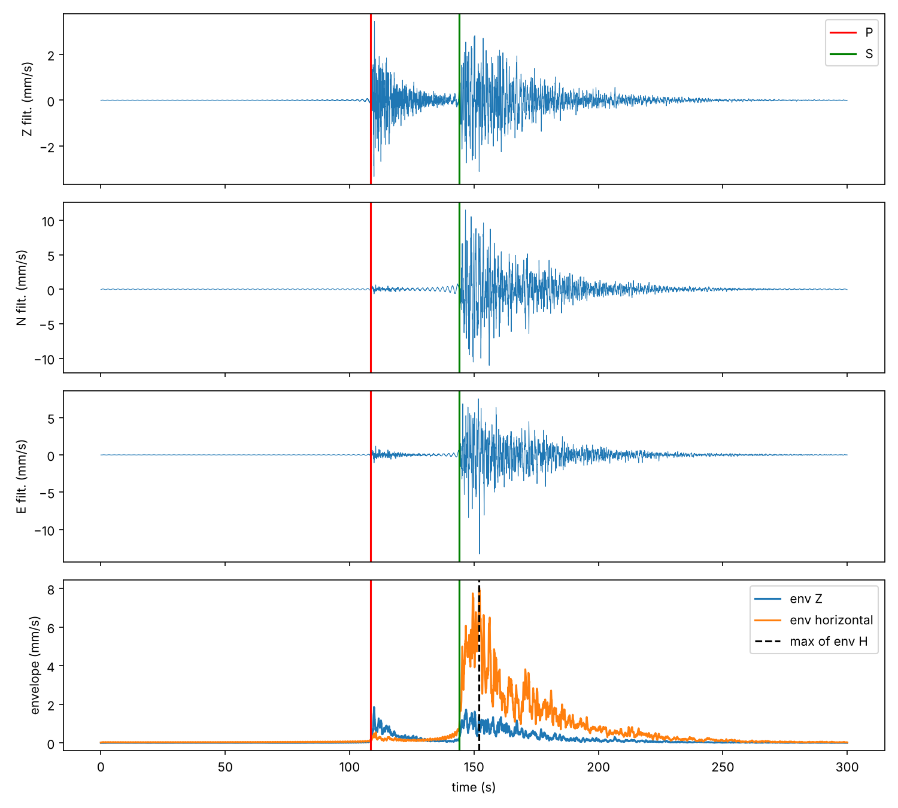
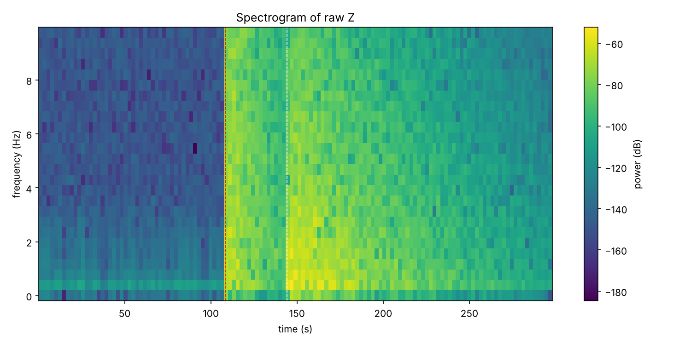

# PW5 – Locating an earthquake from one station
Run: `python explore.py` (steps 1–8, figures), `snakemake --cores 1` (steps 9–10). Band-pass 0.5–10 Hz, envelope window 0.5 s.

**1.**  
P (~108 s) is clearest on Z; S (~144 s) is largest on N and E. Before the quake the ground is not still: there is noise of ~0.007 mm/s.

**2.**  
`fftfreq` turns array indices into Hz. The spectrum is mirrored because the signal is real (|X(−f)| = |X(f)|), which is also why the amplitude is ×2. The noise peaks at 0.1–0.4 Hz (microseism). The quake rises furthest above the noise at 0.5–10 Hz.

**3.** 
`ifft(fft(Z)) == Z` is True: the transform loses nothing, so the filter changes only the zeroed frequencies. The cut-offs leave out the microseism below 0.5 Hz and the noise floor above 10 Hz. Z − clean contains the microseism, the slow surface waves and the >10 Hz part of P.

**4.** 
A 0.05 s window is shorter than one wave period, so the envelope stays spiky. A 5 s window smears the onset ~2.5 s early and flattens the peaks.

**5.** 
tP = 108.42 s, tS = 144.08 s, maximum at 152.03 s. The maximum comes later because the shaking keeps building after the arrival. Using it would give R = 374 km instead of 306 km.

**6.** R = (tS − tP)/(1/vS − 1/vP) = **306.1 km**. A 1 s error in tS changes R by 8.6 km. Origin time = tP − R/vP = **59.04 s**.

**7.** 
P arrives with the highest frequencies, S mostly at 0.5–4 Hz, surface waves last and lowest (<0.5 Hz). The spectrogram shows *when* each frequency arrives; a single spectrum loses the time.

**8.** PGV = 1.51 cm/s, **M = 6.66**. The log10 R term makes up for the amplitude lost with distance. Without it, the same quake at 2R would get a magnitude about 0.55 lower. At the same distance, M + 1 means PGV × 10^0.55 = 3.55, i.e. 5.36 cm/s.

**9.**
| event | tP (s) | tS (s) | R (km) | PGV (cm/s) | M |
|---|---|---|---|---|---|
| A | 108.42 | 144.08 | 306.1 | 1.510 | 6.66 |
| B | 84.25 | 102.43 | 156.1 | 0.571 | 5.36 |

B is closer, A is stronger.

**10.** (a) Both rules run. (b) "Nothing to be done": all outputs are newer than their inputs. (c) After a wording change in report.py, only `report` reruns. (d) After changing b in analyse.py, `analyse` and `report` both rerun. Only what depends on the change is redone.